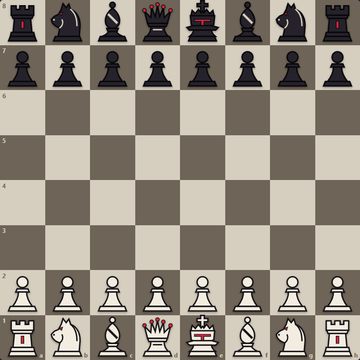
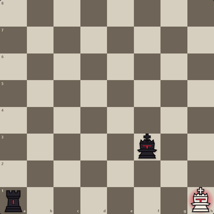
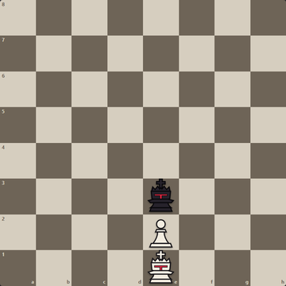
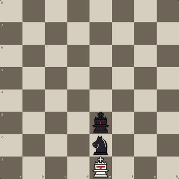
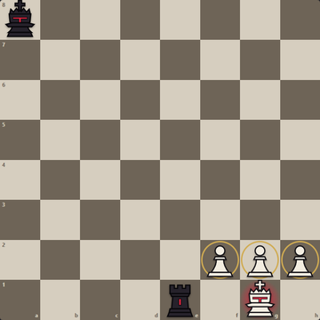
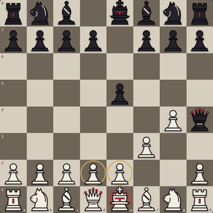
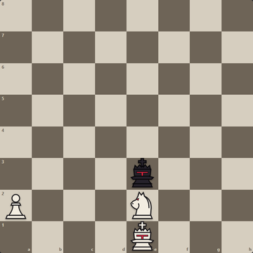

# Chess Variant Pages: listing draft

A draft of the Mean Chess page for [chessvariants.com](https://www.chessvariants.com), following the
plan in [DISCOVERY-AND-LISTING.md](DISCOVERY-AND-LISTING.md) §5 (checklist, classification, follow-up).
**The founder submits it in their own name and writes the introduction's origin story themselves**;
everything else is drawn from [RULES.md](RULES.md), the canonical rules. Re-read the site's live
submission guidance on the day and adjust. (The site was still down on 17 October 2026.)

Diagrams: `public/press/diagrams/1-start.png` to `7-pawns-first.png` (360 px), also at
`https://meanchess.siddheshthapa.com/press/diagrams/…`.

---

## Mean Chess

*Inventor and author: Siddhesh Thapa, 2026. Rules version 0.1.*

### Introduction

> **[Founder: two or three sentences, in your own words, on where the idea came from.]**

Mean Chess is standard chess with three new powers for the king. A king can capture the enemy king
from two squares away, can eat one of its own pieces standing between them to do it, and, trapped in
check, can eat a neighbour of its own to escape. Kings become attackers, king walks become deadly, and
even the classic mates change: Fool's mate fails, while Scholar's mate still works.

Mean Chess can be played free in the browser, with no sign-up, at
https://meanchess.siddheshthapa.com, with a 16-lesson tutorial and a computer opponent.

### Setup

The standard starting position (diagram 1). No new pieces.

### Pieces

All pieces move and capture as in chess. Queens are tracked by origin: each side's queen from the
starting position is its *original* queen; a queen made by promotion is a *promoted* queen for the
rest of the game (written `Q~` in positions). The king gains the moves below.

### Rules

1. **Royal distance.** Two kings are at royal distance when they stand exactly two squares apart on
   the same rank, file or diagonal. The square between them is the *midpoint*. (A knight's jump apart
   is not royal distance.)
2. **Royal Capture.** Only a king can capture a king. If the kings are at royal distance and the
   midpoint is empty, the side to move may capture the enemy king with its king, and wins (diagram 2).
   Royal moves are allowed at any time, including when the mover's king is in check, and are not
   subject to king-safety rules. Other pieces still give check as normal.
3. **Royal Slaughter.** If the midpoint holds one of the mover's own *eligible* pieces (rule 6), the
   king may remove that piece and capture the enemy king as a single move, and wins (diagram 3).
4. **Blocking.** An enemy piece on the midpoint blocks the royal move, and so does one of the mover's
   own pieces that is not eligible, including the original queen. Kings never jump (diagram 4).
5. **The Royal Kill Zone.** A king is in the Kill Zone when the opponent would have a royal move
   against it if it were the opponent's turn. Standing in it, entering it, and castling into, out of
   or through it are all legal, and it is never check, but it usually loses. Adjacent kings remain
   illegal, as in chess.
6. **The sacrifice order.** Tier 1: pawns. Tier 2: knights and bishops. Tier 3: rooks. Tier 4:
   promoted queens. Only pieces of the lowest tier the side still has *anywhere on the board* are
   eligible to be eaten. The original queen and the king are never eligible.
7. **Royal Cannibalism.** A side is *desperate* when its king is in check, it has no royal move, and
   every ordinary legal move it has is *suicidal* (it hands the opponent a royal move) or it has
   none. While desperate, and only then, the king may step onto an adjacent square occupied by one of
   its own eligible pieces, removing that piece, provided the king is not in check afterwards
   (diagram 5). Suicidal ordinary moves remain legal. Without check there is no cannibalism: no legal
   move is stalemate.
8. **Checkmate.** In check with no legal move after all of the above. Fool's mate is not mate: the
   king escapes by eating its d2 or e2 pawn (diagram 6).
9. **Draws.** Stalemate; threefold repetition (applied automatically); the fifty-move rule, counting
   cannibalism as a capture (applied automatically); agreement. **There is no draw for insufficient
   material**: lone kings can still capture each other, and king and knight, or king and bishop,
   against a bare king can win.
10. **Order of endings.** A royal capture or slaughter ends the game first; then checkmate or
    stalemate; then the fifty-move rule; then threefold repetition; then agreement or resignation.
11. **Notation.** Ordinary moves use standard notation. Royal Capture: `K×K`. Royal Slaughter: `K×`
    plus the sacrificed piece plus `×K`, for example `K×P×K`. Royal Cannibalism: `K×` plus the square
    and the piece, for example `K×e2(own P)`.

*Diagram 2. White is in check from the rook on a1, but the black king on f3 is at royal distance with
an empty midpoint: K×K wins.*

*Diagram 3. White's own pawn on e2 stands between the kings: K×P×K wins.*

*Diagram 4. White's king cannot jump the black knight. With Black to move (Black has no pawns, so its
knight is eligible), Black slaughters through it instead.*

*Diagram 5. In chess this is a back-rank mate. In Mean Chess the white king may eat its f2, g2 or h2
pawn to escape.*

*Diagram 6. After 1. f3 e5 2. g4 Qh4, White escapes with K×e2(own P) or K×d2(own P).*

*Diagram 7. White's knight stands between the kings, but White still has a pawn on a2, so the knight
is not eligible: no Royal Slaughter. With the pawn gone, it would be.*

### Notes

- **Strategy.** A piece between the kings is its owner's shield and its owner's weapon: it blocks the
  enemy king, and its owner may slaughter through it. Corners are deadly in endings, because a cornered
  king soon has only suicidal moves.
- **Puzzles.** (a) White: king h1, pawn g2; Black: king f4, rook a1. White to move. *Solution:*
  K×g2(own P). Kh2 is legal but walks into the Kill Zone (two squares from f4 on a diagonal). (b)
  White: king d3; Black: king a1. White to move and win. *Solution:* 1. Kc2! leaves Black only Ka2,
  into the Kill Zone, and 2. K×K follows.
- **Playing it.** Online at https://meanchess.siddheshthapa.com: tutorial, rules, a computer opponent
  at three levels, and games between friends on one device (online play is planned). Source code:
  https://github.com/OnePanda2/Mean.Chess (MIT).
- **Version history.** Rules v0.1, October 2026.
